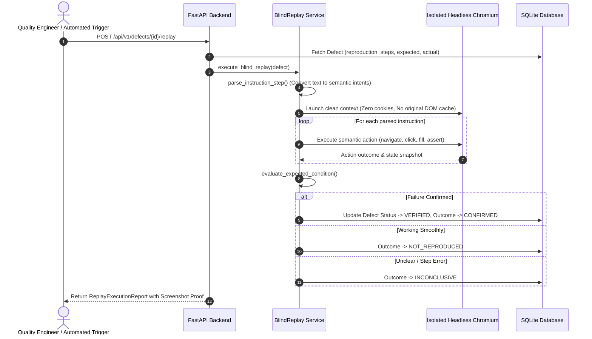

# Veriqo — Autonomous AI Quality Engineering Platform
## Master Technical Specification & Architecture Documentation

> **Tagline**: Intelligence That Tests Itself.  
> **Product Promise**: Ship with proof.  
> **Repository**: `VERIQO_VIT_Apex` (Evaluation & Production Baseline)

---

## Table of Contents

1. [Executive Summary & Product Vision](#1-executive-summary--product-vision)
2. [High-Level Architecture & System Topography](#2-high-level-architecture--system-topography)
3. [Backend Deep Dive (`backend/`)](#3-backend-deep-dive-backend)
   - [3.1 Technology Stack & Core Principles](#31-technology-stack--core-principles)
   - [3.2 Data Models & Database Schema (SQLAlchemy 2.0)](#32-data-models--database-schema-sqlalchemy-20)
   - [3.3 REST API Endpoints & Request Lifecycles](#33-rest-api-endpoints--request-lifecycles)
   - [3.4 Browser Automation Service (`browser.py`)](#34-browser-automation-service-browserpy)
   - [3.5 Independent Defect Verification (`blind_replay.py`)](#35-independent-defect-verification-blind_replaypy)
   - [3.6 Deterministic Scoring & Cryptographic Certificates (`scoring.py`)](#36-deterministic-scoring--cryptographic-certificates-scoringpy)
   - [3.7 Diagnostic Diagnostics & Fix Prompt Generation (`show_me.py`)](#37-diagnostic-diagnostics--fix-prompt-generation-show_mepy)
4. [Frontend Deep Dive (`frontend/`)](#4-frontend-deep-dive-frontend)
   - [3.1 Next.js 16 App Router & Neo-Brutalist Stitch UI](#41-nextjs-16-app-router--neo-brutalist-stitch-ui)
   - [4.2 Architecture: Dual-Layer Gateway & Backend Bridge](#42-architecture-dual-layer-gateway--backend-bridge)
   - [4.3 Telemetry & Command Center (`/command-center`)](#43-telemetry--command-center-command-center)
   - [4.4 Fleet Project Management (`/projects`)](#44-fleet-project-management-projects)
   - [4.5 Test Run Intelligence & Evidence Viewer (`/test-runs`)](#45-test-run-intelligence--evidence-viewer-test-runs)
   - [4.6 Defect Triage, Show Me Mode & BlindReplay Console (`/bug-reports`)](#46-defect-triage-show-me-mode--blindreplay-console-bug-reports)
   - [4.7 Regression Test Library (`/test-library`)](#47-regression-test-library-test-library)
   - [4.8 Analytics, Pass Rate Heatmaps & Trends (`/analytics`)](#48-analytics-pass-rate-heatmaps--trends-analytics)
   - [4.9 Integrations & Artifact Ingestion (`/integrations`)](#49-integrations--artifact-ingestion-integrations)
   - [4.10 Cluster & Agent Settings (`/settings`)](#410-cluster--agent-settings-settings)
   - [4.11 Interactive Modals & Command Overlays](#411-interactive-modals--command-overlays)
5. [Core Algorithmic Engines & Workflow Mechanics](#5-core-algorithmic-engines--workflow-mechanics)
   - [5.1 The BlindReplay Zero-Context Verification Algorithm](#51-the-blindreplay-zero-context-verification-algorithm)
   - [5.2 Deterministic QA Scoring Formula & Penalty Caps](#52-deterministic-qa-scoring-formula--penalty-caps)
   - [5.3 Cryptographic Integrity Checksum & Tamper Detection](#53-cryptographic-integrity-checksum--tamper-detection)
   - [5.4 Origin Sandboxing & Security Enforcement](#54-origin-sandboxing--security-enforcement)
6. [Testing Harness, Benchmarks & Validation](#6-testing-harness-benchmarks--validation)
   - [6.1 Controlled Functional Benchmark Suite (`benchmark.py`)](#61-controlled-functional-benchmark-suite-benchmarkpy)
   - [6.2 Self-Contained Local Target Fixture (`demo_fixture.py`)](#62-self-contained-local-target-fixture-demo_fixturepy)
   - [6.3 Pytest Integration & Unit Test Suite](#63-pytest-integration--unit-test-suite)
   - [6.4 Frontend Type Safety & Production Compilation](#64-frontend-type-safety--production-compilation)
7. [Installation, Configuration & Operational Guide](#7-installation-configuration--operational-guide)
   - [7.1 System Prerequisites](#71-system-prerequisites)
   - [7.2 Automated One-Click Development Launcher (`start-dev.ps1`)](#72-automated-one-click-development-launcher-start-devps1)
   - [7.3 Manual Step-by-Step Installation](#73-manual-step-by-step-installation)
   - [7.4 Environment Variables Reference](#74-environment-variables-reference)
   - [7.5 Operational Troubleshooting](#75-operational-troubleshooting)

---

## 1. Executive Summary & Product Vision

Modern software engineering moves at breakneck speed, but Quality Assurance (QA) remains one of the largest bottlenecks in the release lifecycle. Traditional end-to-end (E2E) testing frameworks suffer from:
1. **Flaky tests** caused by brittle DOM selectors and asynchronous timing hazards.
2. **High maintenance overhead**, where trivial UI style changes break test scripts.
3. **Subjective quality decisions**, where release approvals depend on incomplete checklists rather than mathematical proof.
4. **Delayed root cause diagnosis**, where engineers spend hours triaging test logs to reproduce failures.

**Veriqo** solves these challenges by acting as an **Autonomous AI Quality Engineering Platform**. It operates headless browser agents to navigate web targets, captures step-by-step screenshot evidence, logs runtime DOM events, validates functional assertions, triages regressions, executes **BlindReplay** to independently confirm defect authenticity without human intervention, and issues tamper-proof, cryptographically signed **QA Certificates**.

```
                ┌──────────────────────────────────────────────┐
                │             TARGET WEB APPLICATION           │
                │        (Staging / Preview / Production)      │
                └──────────────────────▲───────────────────────┘
                                       │ Real Playwright Navigation
                                       │ (Strict Origin Sandboxing)
   ┌───────────────────────────────────┴───────────────────────────────────┐
   │                                                                       │
┌──┴───────────────────────────┐                       ┌───────────────────┴───┐
│     FASTAPI BACKEND          │◄────── HTTP/BFF ──────┤   NEXT.JS 16 FRONTEND │
│  - Playwright Chromium Engine│                       │  - Neo-Brutalist UI   │
│  - BlindReplay Engine        │                       │  - Live Telemetry     │
│  - Deterministic Scorer      │                       │  - Show Me Diagnostics│
│  - SQLite / SQLAlchemy 2.0   │                       │  - QA Cert Verifier   │
│  - SHA-256 Certificate Vault │                       │  - Swarm Command Bar  │
└──────────────────────────────┘                       └───────────────────────┘
```

---

## 2. High-Level Architecture & System Topography

The workspace is organized as a unified monorepo consisting of:
- **`backend/`**: A high-concurrency Python FastAPI service powering browser automation, independent reproduction algorithms, diagnostic generators, and deterministic scoring.
- **`frontend/`**: A Next.js 16 (React 19) web dashboard and API Gateway (BFF) adhering to a high-aesthetic neo-brutalist "Stitch" design system.
- **`start-dev.ps1`**: A resilient Windows PowerShell orchestration script managing ports, background jobs, and process lifecycles.

### Monorepo Structure

```text
VERIQO_VIT_Apex/
├── backend/
│   ├── app/
│   │   ├── api/v1/                   # REST routing tier
│   │   │   ├── analytics.py          # Metric aggregation endpoints
│   │   │   ├── bug_reports.py        # Show-me, fix-prompt & defect endpoints
│   │   │   ├── certificates.py       # Deterministic QA certificates & validation
│   │   │   ├── defects.py            # Defect triage & management
│   │   │   ├── integrations.py       # GitHub, CI/CD webhooks, OpenAPI ingestion
│   │   │   ├── logs.py               # Live terminal output streaming
│   │   │   ├── projects.py           # Connected application management
│   │   │   ├── regression_journeys.py# Saved journey regression baselines
│   │   │   ├── replays.py            # BlindReplay verification triggers
│   │   │   ├── router.py             # Master API router combining all domains
│   │   │   ├── target_apps.py        # Target app registration & details
│   │   │   ├── test_library.py       # Test case catalogue & suites
│   │   │   └── test_runs.py          # Browser test dispatch & execution logs
│   │   ├── core/                     # Configuration, logging & security policies
│   │   │   ├── config.py             # Pydantic v2 settings & environment variables
│   │   │   └── logging.py            # Structured logging formatters
│   │   ├── db/                       # Database engine & session management
│   │   │   ├── base.py               # SQLAlchemy DeclarativeBase
│   │   │   └── session.py            # Thread-safe SQLite engine with WAL mode
│   │   ├── models/                   # SQLAlchemy 2.0 ORM entities
│   │   │   ├── certificate.py        # Cryptographic certificate records
│   │   │   ├── defect.py             # Discovered flaws & reproduction steps
│   │   │   ├── regression_journey.py # Reusable journey definitions
│   │   │   ├── replay_attempt.py     # Independent BlindReplay verification logs
│   │   │   ├── target_app.py         # Target web applications
│   │   │   └── test_run.py           # Test execution sessions & action traces
│   │   ├── schemas/                  # Pydantic v2 request/response schemas
│   │   │   ├── certificate.py        # Certificate payload & verification DTOs
│   │   │   ├── defect.py             # Defect DTOs
│   │   │   ├── fix_prompt.py         # Structured Markdown developer prompts
│   │   │   ├── health.py             # Health/readiness probe schemas
│   │   │   ├── journey.py            # Action definitions & execution reports
│   │   │   ├── regression_journey.py # Regression journey DTOs
│   │   │   ├── replay_attempt.py     # BlindReplay attempt DTOs
│   │   │   ├── show_me.py            # Diagnostic explanations & evidence DTOs
│   │   │   ├── target_app.py         # TargetApp DTOs
│   │   │   └── test_run.py           # TestRun DTOs
│   │   ├── services/                 # Core domain algorithmic engines
│   │   │   ├── blind_replay.py       # Zero-context independent defect verifier
│   │   │   ├── browser.py            # Headless Playwright runner & origin sandboxing
│   │   │   ├── scoring.py            # Deterministic QA scoring & SHA-256 cert generator
│   │   │   └── show_me.py            # Root-cause diagnostic & fix prompt generator
│   │   ├── benchmark.py              # Controlled 6-scenario functional benchmark
│   │   ├── demo_fixture.py           # Embedded local mock store target for offline demo
│   │   ├── main.py                   # FastAPI initialization & lifespans
│   │   └── reset_demo.py             # Deterministic seed data resetter
│   ├── evidence/                     # On-disk screenshot repository
│   ├── tests/                        # 115 comprehensive pytest tests
│   ├── requirements.txt              # Pinned Python package dependencies
│   ├── .env.example                  # Backend environment template
│   └── veriqo.db                     # Persistent SQLite database file
├── frontend/
│   ├── app/                          # Next.js 16 App Router pages & API Gateway
│   │   ├── analytics/page.tsx        # Quantitative QA metrics & pass rate heatmaps
│   │   ├── api/v1/                   # Backend-For-Frontend (BFF) proxy routes
│   │   │   ├── analytics/route.ts
│   │   │   ├── bug-reports/route.ts
│   │   │   ├── certificates/route.ts
│   │   │   ├── evidence/[...path]/route.ts
│   │   │   ├── health/route.ts
│   │   │   ├── integrations/route.ts
│   │   │   ├── logs/route.ts
│   │   │   ├── projects/route.ts
│   │   │   ├── test-library/route.ts
│   │   │   └── test-runs/route.ts
│   │   ├── bug-reports/page.tsx      # Defect triage, Show Me Mode & BlindReplay
│   │   ├── command-center/page.tsx   # Live Chromium view & swarm telemetry
│   │   ├── integrations/page.tsx     # GitHub, OpenAPI & webhook settings
│   │   ├── projects/page.tsx         # Fleet project catalog & certificate issuance
│   │   ├── settings/page.tsx         # Engine parameters & browser options
│   │   ├── test-library/page.tsx     # Regression baseline library
│   │   ├── test-runs/page.tsx        # Execution log & status viewer
│   │   ├── layout.tsx                # Neo-brutalist root layout & sidebar shell
│   │   └── page.tsx                  # Root redirect to /command-center
│   ├── components/                   # Modular React UI component hierarchy
│   │   ├── agents/                   # TerminalPanel & AgentStatusCard
│   │   ├── certificates/             # CertificateModal & TamperVerifier
│   │   ├── dashboard/                # ProjectCard & FleetOverview
│   │   ├── evidence/                 # EvidenceModal & CriticalDefectCard
│   │   ├── forms/                    # ConnectAppModal, NewTestRunModal, GlobalSearchModal
│   │   ├── layout/                   # AppHeader, AppSidebar, Breadcrumbs
│   │   ├── testing/                  # BrowserPreview & CommandBar
│   │   └── ui/                       # Buttons, Badges, Icons, FormControls, StateViews
│   ├── lib/                          # Client & server data infrastructure
│   │   ├── api-client.ts             # Typed browser-side client
│   │   ├── backend-bridge.ts         # High-reliability server-side HTTP proxy
│   │   ├── db.ts                     # In-memory resilient offline fallback database
│   │   ├── mock-data.ts              # Rich seed data for offline / standalone preview
│   │   └── types.ts                  # Shared TypeScript interfaces
│   ├── package.json                  # Pinned npm dependencies
│   └── .env.example                  # Frontend environment template
├── start-dev.ps1                     # Dev launcher with background jobs & port triage
└── README.md                         # Main repository entrypoint
```

---

## 3. Backend Deep Dive (`backend/`)

### 3.1 Technology Stack & Core Principles

The backend is built with:
- **FastAPI**: Asynchronous web framework offering native OpenAPI documentation generation and strict request parsing.
- **SQLAlchemy 2.0**: Declarative ORM mapped to a local SQLite database (`veriqo.db`) with Write-Ahead Logging (WAL) and foreign keys enabled.
- **Pydantic v2**: High-speed validation of data payloads and schemas.
- **Playwright Python**: Headless browser automation controlling Chromium and Chromium Headless Shell.
- **Pytest**: Automated testing framework with HTTPX test client and mock HTTP servers.

Core design rules adhered to across the backend:
1. **Zero External LLM Dependency for Core Workflows**: Autonomous exploration, assertion verification, BlindReplay, and scoring are deterministic and require no paid API keys.
2. **Strict Origin Enforcement**: Browser sessions are sandboxed to the target application's origin to prevent Server-Side Request Forgery (SSRF) and data exfiltration.
3. **Immutability of Evidence**: Screenshot files captured on disk are referenced via relative paths, audited during scoring, and cryptographically verified.

---

### 3.2 Data Models & Database Schema (SQLAlchemy 2.0)

All models inherit from `app.db.base.Base` and are stored with UTC timestamps:

#### 1. `TargetApp` (`app/models/target_app.py`)
Represents an enrolled web application target under test.
- `id`: Integer primary key.
- `name`: Human-readable application name (e.g., `Commerce Platform`).
- `url`: Base URL of the web application (e.g., `https://shop.acmeflow.dev`).
- `description`: Optional text describing the target application.
- `created_at` / `updated_at`: UTC timestamps.
- **Relationships**:
  - `test_runs`: 1-to-many relationship with `TestRun`.
  - `defects`: 1-to-many relationship with `Defect`.
  - `regression_journeys`: 1-to-many relationship with `RegressionJourney`.
  - `certificates`: 1-to-many relationship with `Certificate`.

#### 2. `TestRun` (`app/models/test_run.py`)
Represents an individual execution of a test journey.
- `id`: Integer primary key.
- `target_app_id`: Foreign key referencing `TargetApp.id`.
- `status`: String state (`running`, `passed`, `failed`, `timed_out`).
- `journey_definition`: JSON column containing sequence of action steps.
- `started_at` / `completed_at`: UTC timestamps.
- `action_results`: JSON column with step-by-step execution logs, statuses, durations, and screenshot paths.
- `error_message`: Optional error details if the run failed.
- `evidence_paths`: JSON list of screenshot relative paths.
- **Relationships**:
  - `defects`: 1-to-many relationship with `Defect`.

#### 3. `Defect` (`app/models/defect.py`)
Represents a functional bug or assertion failure discovered during testing.
- `id`: Integer primary key.
- `target_app_id`: Foreign key referencing `TargetApp.id`.
- `test_run_id`: Foreign key referencing `TestRun.id`.
- `title`: Short descriptive title of the defect.
- `description`: Detailed explanation of the failure.
- `severity`: Severity classification (`CRITICAL`, `HIGH`, `MEDIUM`, `LOW`).
- `status`: Workflow state (`OPEN`, `VERIFIED`, `RESOLVED`, `FALSE_POSITIVE`, `INCONCLUSIVE`).
- `reproduction_steps`: JSON list of human-readable action steps required to reproduce the bug.
- `expected_behavior`: What should have occurred.
- `actual_behavior`: What actually occurred.
- `created_at` / `updated_at`: UTC timestamps.
- **Relationships**:
  - `replay_attempts`: 1-to-many relationship with `ReplayAttempt`.

#### 4. `RegressionJourney` (`app/models/regression_journey.py`)
Represents a curated, reusable test journey saved to the regression library.
- `id`: Integer primary key.
- `target_app_id`: Foreign key referencing `TargetApp.id`.
- `name`: Name of the regression journey (e.g., `Guest Checkout Flow`).
- `description`: Optional documentation.
- `actions`: JSON list of typed journey actions.
- `created_at`: UTC timestamp.

#### 5. `ReplayAttempt` (`app/models/replay_attempt.py`)
Represents an independent verification execution executed by BlindReplay.
- `id`: Integer primary key.
- `defect_id`: Foreign key referencing `Defect.id`.
- `outcome`: State result (`CONFIRMED`, `NOT_REPRODUCED`, `INCONCLUSIVE`, `FAILED`, `TIMED_OUT`).
- `started_at` / `completed_at`: UTC timestamps.
- `execution_log`: JSON list of actions performed and evaluated states.
- `evidence_paths`: JSON list of screenshot artifacts captured during the attempt.
- `error_message`: Optional error description.

#### 6. `Certificate` (`app/models/certificate.py`)
Represents a cryptographically sealed quality assurance attestation.
- `id`: Integer primary key.
- `target_app_id`: Foreign key referencing `TargetApp.id`.
- `qa_score`: Deterministic composite score (float between `0.0` and `100.0`).
- `score_breakdown`: JSON detailing pass rates, penalties, and caps applied.
- `tamper_hash`: Hexadecimal SHA-256 digest of canonical certificate JSON.
- `certificate_json`: Full deterministic JSON payload of the certificate.
- `created_at`: UTC timestamp of issuance.

---

### 3.3 REST API Endpoints & Request Lifecycles

The master router (`app/api/v1/router.py`) exposes the following endpoints under `/api/v1`:

| Domain | Method | Route | Description |
| :--- | :--- | :--- | :--- |
| **System** | `GET` | `/health` | Process liveness check (instant 200 OK) |
| **System** | `GET` | `/ready` | Database connectivity readiness probe |
| **System** | `GET` | `/api/v1/info` | API version, service name, and environment |
| **Target Apps** | `GET` | `/api/v1/target-apps` | List all registered target applications |
| **Target Apps** | `POST` | `/api/v1/target-apps` | Register a new target application URL |
| **Target Apps** | `GET` | `/api/v1/target-apps/{id}` | Retrieve details of a specific target application |
| **Test Runs** | `POST` | `/api/v1/target-apps/{id}/test-runs` | Dispatch and execute a new browser test journey |
| **Test Runs** | `GET` | `/api/v1/target-apps/{id}/test-runs` | List test runs associated with a target app |
| **Test Runs** | `GET` | `/api/v1/test-runs/{id}` | Fetch test run execution results and logs |
| **Test Runs** | `GET` | `/api/v1/test-runs/active` | Get currently running test journeys |
| **Defects** | `GET` | `/api/v1/defects` | Query defects across apps with severity/status filters |
| **Defects** | `POST` | `/api/v1/defects` | Log a newly discovered defect |
| **Defects** | `GET` | `/api/v1/defects/{id}` | Retrieve defect details |
| **Defects** | `PATCH` | `/api/v1/defects/{id}` | Update defect status (e.g., mark as RESOLVED) |
| **Show Me** | `GET` | `/api/v1/defects/{id}/show-me` | Root-cause diagnostic analysis & visual evidence |
| **Fix Prompt** | `GET` | `/api/v1/defects/{id}/fix-prompt` | Structured Markdown bug report for developer IDEs |
| **Replays** | `POST` | `/api/v1/defects/{id}/replay` | Trigger zero-context BlindReplay verification |
| **Replays** | `GET` | `/api/v1/defects/{id}/replays` | Retrieve history of BlindReplay attempts |
| **Certificates** | `POST` | `/api/v1/target-apps/{id}/certificates` | Compute deterministic score and issue QA certificate |
| **Certificates** | `GET` | `/api/v1/target-apps/{id}/certificates` | Retrieve issued QA certificates for an application |
| **Certificates** | `POST` | `/api/v1/certificates/verify` | Dual-mode cryptographic tamper verification |
| **Regression** | `GET` | `/api/v1/target-apps/{id}/regression-journeys` | List saved regression baselines |
| **Regression** | `POST` | `/api/v1/target-apps/{id}/regression-journeys` | Save a successful journey as a regression baseline |
| **Regression** | `POST` | `/api/v1/regression-journeys/{id}/execute` | Re-run a saved regression journey |
| **Analytics** | `GET` | `/api/v1/analytics` | Fleet quality index, pass rates, and trends |
| **Integrations** | `GET` | `/api/v1/integrations` | Active integration webhooks, GitHub App status |
| **Logs** | `GET` | `/api/v1/logs` | Real-time terminal log stream |

---

### 3.4 Browser Automation Service (`browser.py`)

The browser automation runner is implemented in `app/services/browser.py` using Playwright:
1. **Safe Origin Resolution (`resolve_safe_target_url`)**:
   - Parses target URLs and normalizes hostnames.
   - Restricts navigations to the designated target origin.
   - Forbids private loopback subnets unless running in explicit local development mode.
2. **Action Execution Loop**:
   Executes ordered actions defined in the journey payload:
   - `navigate`: Navigates to a path relative to the base URL.
   - `click`: Locates an element using text or selector and performs a user click.
   - `fill`: Clears an input and enters simulated keyboard text.
   - `assert_text_visible`: Verifies specified text exists in the visible DOM within the timeout threshold.
   - `assert_element_visible`: Verifies an element matching the selector is present and visible.
3. **Evidence Capture**:
   - For every step or assertion, screenshots are captured and saved to `backend/evidence/run_{run_id}/step_{idx}.png`.
   - On completion or failure, a final screenshot (`completion.png` or `failure.png`) is recorded.
   - Relative paths are returned in the execution report.

---

### 3.5 Independent Defect Verification (`blind_replay.py`)

A primary flaw in automated testing is **test bias**: when a test script fails, rerunning the exact same brittle script often repeats the same timing error or false assumption.

**BlindReplay** eliminates this bias:
1. **Zero Prior Context**:
   - Launches an independent, isolated browser context.
   - Does **not** inherit cookies, localStorage, session state, or previous DOM selector references.
2. **Semantic Intent Parsing (`parse_instruction_step`)**:
   - Converts human-readable reproduction steps (e.g., `Click "Add to Cart"`, `Type "john@example.com" into email`) into semantic action intents (`navigate`, `click`, `fill`, `assert`).
3. **Execution & Evaluation**:
   - Dispatches the semantic actions against the target application.
   - Checks whether the failure occurs independently.
   - If the error reproduces, the defect status updates to `VERIFIED` and the attempt outcome is marked `CONFIRMED`.
   - If the flow succeeds without error, the outcome is marked `NOT_REPRODUCED`.
   - If instructions are unclear or elements cannot be found due to ambiguous steps, the outcome is marked `INCONCLUSIVE`.

---

### 3.6 Deterministic Scoring & Cryptographic Certificates (`scoring.py`)

The deterministic scoring service calculates an objective QA Score from `0.0` to `100.0`:

#### 1. Pass Rate Computation
- **Journey Pass Rate ($J$)**: Ratio of passed test runs to total test runs.
- **Assertion Pass Rate ($A$)**: Ratio of passed assertions to total assertions.
- **Base Score ($S_{base}$)**:
  $$S_{base} = (0.4 \times J) + (0.6 \times A)$$
  *(If no assertions exist, $S_{base} = J$, subject to a strict cap of 75.0).*

#### 2. Penalty Schedule
Deductions are subtracted for outstanding defects:
- **Verified Critical Defect**: $-35.0$ points each
- **Verified High Defect**: $-20.0$ points each
- **Verified Medium Defect**: $-10.0$ points each
- **Verified Low Defect**: $-5.0$ points each
- **Non-Verified Defect Ratio**: Non-verified defects are penalized at $50\%$ of the verified rate.

#### 3. Ceiling Caps
- If any Verified Critical defect exists: Score is capped at **$\le 40.0$**.
- If any Verified High defect exists: Score is capped at **$\le 65.0$**.
- If no assertions were run: Score is capped at **$\le 75.0$**.

#### 4. Evidence Audit
Before issuing a certificate, `audit_evidence()` scans the disk:
- Every passed run must have a completion screenshot.
- Every confirmed replay must have visual proof artifacts.
- Each missing artifact incurs a **$-5.0$ point audit penalty**.

#### 5. Canonical SHA-256 Serialization
To make QA Certificates tamper-proof:
1. Floating-point numbers are rounded to 4 decimal places.
2. Datetimes are formatted to ISO 8601 UTC with `Z` suffix.
3. Keys are alphabetically sorted and serialized to compact UTF-8 JSON without whitespace.
4. The unkeyed SHA-256 digest is generated and sealed as `tamper_hash`.
5. When verified later (via `POST /api/v1/certificates/verify`), any alteration of the certificate payload or score immediately flags the certificate as **TAMPERED**.

---

### 3.7 Diagnostic Diagnostics & Fix Prompt Generation (`show_me.py`)

When an engineer inspects a defect, Veriqo eliminates triage friction via:
1. **Show Me Mode (`GET /api/v1/defects/{id}/show-me`)**:
   - Synthesizes the test run context, failed action step, and error trace.
   - Pairs the expected behavior screenshot with the failure screenshot.
   - Provides a natural language diagnostic root cause analysis.
   - Automatically sanitizes passwords, session cookies, and API tokens (`[REDACTED]`).
2. **Fix Prompt Export (`GET /api/v1/defects/{id}/fix-prompt`)**:
   - Formats the complete defect context into a high-density, structured Markdown prompt.
   - Ready for pasting directly into AI coding assistants (e.g., Antigravity, Claude, Cursor) to generate instant bug fixes.

---

## 4. Frontend Deep Dive (`frontend/`)

### 4.1 Next.js 16 App Router & Neo-Brutalist Stitch UI

The frontend is built using Next.js 16 with React 19, styled using Tailwind CSS according to the **Neo-Brutalist Stitch UI** aesthetic:
- **Palette**: Warm cream background (`#FAF9F6`), pure white cards (`#FFFFFF`), solid ink borders (`#1A1C1A`), deep forest primary accents (`#285C45`), mint highlights (`#B7EFD0`), and coral alerts (`#EE5B43`).
- **Tactile Depth**: Brutalist hard drop-shadows (`box-shadow: 4px 4px 0px #1A1C1A`).
- **Typography**: Space Grotesk for bold headers, Inter for readable body text, and JetBrains Mono for telemetry logs, hashes, and code metrics.

---

### 4.2 Architecture: Dual-Layer Gateway & Backend Bridge

The frontend uses a high-reliability dual-layer communication model:

```
[Browser UI]
    │
    ▼ (HTTP requests via `lib/api-client.ts`)
[Next.js App Router Route Handlers: `app/api/v1/*`]
    │
    ▼ (Server-to-Server HTTP via `lib/backend-bridge.ts`)
[FastAPI Backend: `http://127.0.0.1:8000/api/v1/*`]
    │
    ▼ (If backend offline / unreachable)
[In-Memory Resilient DB Fallback: `lib/db.ts` / `lib/mock-data.ts`]
```

- **Client Layer (`lib/api-client.ts`)**: Type-safe client consumed by React components. Automatically handles JSON parsing, error states, and abort signals.
- **Server Gateway Layer (`lib/backend-bridge.ts`)**: Server-side client executing inside Next.js Node.js runtime. Bridges requests to the FastAPI backend, proxies screenshot images securely from `backend/evidence`, and gracefully fails over to the embedded database if the backend is initializing or unreachable.

---

### 4.3 Telemetry & Command Center (`/command-center`)

The central operational hub of Veriqo:
- **Live Chromium View (`BrowserPreview.tsx`)**: Displays real-time screenshots and execution state of the active headless browser session. Includes simulated viewport controls, zoom scaling, and URL status indicators.
- **Interactive Terminal Panel (`TerminalPanel.tsx`)**: Streams real-time agent output, Playwright navigation logs, assertion evaluations, and console warnings with syntax highlighting.
- **Swarm Command Bar (`CommandBar.tsx`)**: Provides one-click test execution controls, target URL input, and mode selection (`Deep Heuristic`, `Fuzzing`, `Regression Baseline`).
- **Agent Swarm Status (`AgentStatusCard.tsx`)**: Displays cluster metrics, including active Chromium instances, CPU/memory utilization, and agent health.

---

### 4.4 Fleet Project Management (`/projects`)

Manages all enrolled web applications:
- Displays target cards with domain names, environments (`Production`, `Staging`, `Canary`, `Preview`), and swarm modes.
- Calculates and displays real-time **QA Health Scores** for each project.
- Displays latest issued QA certificates with verified SHA-256 badges.
- Includes the **Connect Application Modal** for registering new web apps via direct URL, GitHub repository, or OpenAPI specification.

---

### 4.5 Test Run Intelligence & Evidence Viewer (`/test-runs`)

Comprehensive history and active view of all test executions:
- Filterable by status (`All`, `Passed`, `Failed`, `Running`, `Timed Out`).
- Displays execution metrics: duration, total steps completed, passed assertions, and timestamp.
- Step-by-step breakdown showing exact actions, parameters, durations, and inline screenshot thumbnails.
- Direct link to inspect captured defect reports.

---

### 4.6 Defect Triage, Show Me Mode & BlindReplay Console (`/bug-reports`)

The nerve center for quality engineers:
- **Severity Classification**: Color-coded badges for `CRITICAL`, `HIGH`, `MEDIUM`, and `LOW`.
- **Status Triage**: Filter by `OPEN`, `VERIFIED`, `RESOLVED`, or `INCONCLUSIVE`.
- **Show Me Mode Modal**: One-click visual root-cause diagnosis displaying side-by-side screenshot comparisons and sanitized reproduction logs.
- **BlindReplay Trigger**: Executes independent verification on demand with real-time outcome reporting.
- **Developer Fix Prompt Modal**: Generates and copies ready-to-use AI developer fix prompts.
- **Playwright Script Export**: Copies executable standalone TypeScript Playwright scripts that reproduce the bug directly on a developer's local machine.

---

### 4.7 Regression Test Library (`/test-library`)

Maintains proven regression baselines:
- Catalogs validated test journeys across applications.
- Allows one-click re-execution of regression suites against new deployments.
- Displays historical pass/fail trends and execution stability scores.

---

### 4.8 Analytics, Pass Rate Heatmaps & Trends (`/analytics`)

High-level quantitative quality intelligence:
- **Fleet Quality Index**: Macro score across all connected applications.
- **Execution Trend Charts**: Weekly pass/fail distributions and runtime stability.
- **Defect Severity Distribution**: Breakdown of critical vs. non-critical issues.
- **Pass Rate Heatmap**: Identifies problematic target routes and unstable journeys.

---

### 4.9 Integrations & Artifact Ingestion (`/integrations`)

Connects Veriqo into the broader engineering ecosystem:
- **GitHub App**: Pull request status checks, automated regression runs on PR creation, and automatic issue creation for verified defects.
- **CI/CD Webhooks**: Trigger endpoints for GitHub Actions, GitLab CI, and Jenkins.
- **Artifact Ingestion**: Drag-and-drop ingestion of OpenAPI 3.1 specifications and HAR network traffic traces to automatically generate journeys.

---

### 4.10 Cluster & Agent Settings (`/settings`)

Fine-grained control over execution environments:
- **Headless Chromium Flags**: Toggle GPU acceleration, sandbox modes, and user-agent emulation.
- **Timeout Configurations**: Configure navigation timeouts, assertion wait limits, and network idle thresholds.
- **Security & Tokens**: Configure origin allowlists, authentication headers, and secret masking rules.

---

### 4.11 Interactive Modals & Command Overlays

- **`ConnectAppModal.tsx`**: Tabbed modal for connecting applications via URL, GitHub, or OpenAPI spec.
- **`GlobalSearchModal.tsx`**: Command palette invoked via `Ctrl+K` / `Cmd+K`. Allows fast keyboard navigation across routes, defects, and projects, with clickable ESC and backdrop dismissal.
- **`CertificateModal.tsx`**: Full-screen certificate viewer displaying the canonical JSON, SHA-256 hash, and live tamper verification.
- **`EvidenceModal.tsx`**: High-resolution screenshot zoom and trace inspector.
- **`NewTestRunModal.tsx`**: Fast test journey dispatcher with customizable target selection and heuristic modes.

---

## 5. Core Algorithmic Engines & Workflow Mechanics

### 5.1 The BlindReplay Zero-Context Verification Algorithm



1. **Isolation**: Launches a completely pristine Chromium context.
2. **Selector Independence**: Ignores brittle original XPath/CSS selectors; relies on user-visible labels, button text, and accessible roles.
3. **Truthful Outcome**: A defect is only confirmed if the expected condition is demonstrably violated under clean conditions.

---

### 5.2 Deterministic QA Scoring Formula & Penalty Caps

```text
               ┌────────────────────────────────────────────────────────┐
               │                  Test Run Executions                   │
               │        Journey Pass Rate (40%) + Assertion (60%)       │
               └───────────────────────────┬────────────────────────────┘
                                           │
                                           ▼
               ┌────────────────────────────────────────────────────────┐
               │                     Base Score                         │
               │                   (Max: 100.0)                         │
               └───────────────────────────┬────────────────────────────┘
                                           │
                                           ▼
               ┌────────────────────────────────────────────────────────┐
               │               Defect Penalties Subtracted              │
               │   Verified:   Critical (-35), High (-20), Med (-10)    │
               │   Unverified: 50% of verified penalty schedule         │
               └───────────────────────────┬────────────────────────────┘
                                           │
                                           ▼
               ┌────────────────────────────────────────────────────────┐
               │              Evidence Audit Deductions                 │
               │           (-5 points per missing screenshot)           │
               └───────────────────────────┬────────────────────────────┘
                                           │
                                           ▼
               ┌────────────────────────────────────────────────────────┐
               │                  Ceiling Cap Enforcement               │
               │        Verified Critical Exists  ==> Score <= 40.0     │
               │        Verified High Exists      ==> Score <= 65.0     │
               │        No Assertions Executed    ==> Score <= 75.0     │
               └───────────────────────────┬────────────────────────────┘
                                           │
                                           ▼
                               ┌──────────────────────┐
                               │   FINAL QA SCORE     │
                               │    (0.0 - 100.0)     │
                               └──────────────────────┘
```

---

### 5.3 Cryptographic Integrity Checksum & Tamper Detection

1. **Payload Canonicalization**:
   The certificate data structure is scrubbed:
   - Floats rounded to 4 decimals (`round(val, 4)`).
   - Datetimes converted to UTC ISO 8601 strings.
   - Keys sorted alphabetically (`sort_keys=True`).
   - Compact delimiters (`separators=(',', ':')`).
2. **Hashing**:
   $$\text{Hash} = \text{SHA-256}(\text{Canonical UTF-8 Bytes})$$
3. **Dual-Mode Verification**:
   - **Self-Contained Mode**: Computes the hash over the provided certificate payload and verifies it against the embedded `tamper_hash`. If anyone changes the score from `38.5` to `98.5`, the hash mismatch immediately fails verification.
   - **Database-Backed Mode**: Re-runs the complete scoring algorithm against current database records to detect if database entries were altered post-issuance.

---

### 5.4 Origin Sandboxing & Security Enforcement

To protect internal infrastructure and prevent malicious payloads:
- All target URLs must use `http` or `https`.
- Navigation during test runs is restricted to the registered target origin.
- Attempts to navigate to external hosts, cloud metadata endpoints (`169.254.169.254`), or unauthorized local ports are immediately blocked.
- Screenshots and logs automatically mask sensitive authentication tokens, authorization headers, and passwords.

---

## 6. Testing Harness, Benchmarks & Validation

### 6.1 Controlled Functional Benchmark Suite (`benchmark.py`)

Veriqo includes a self-contained 6-scenario functional benchmark runnable via:
```powershell
cd backend
.\.venv\Scripts\python.exe -m app.benchmark
```

| # | Scenario Name | Target Flow | Expected Outcome | Verified Metric |
| :---: | :--- | :--- | :--- | :--- |
| **1** | Happy Path Navigation | Healthy Store Checkout | Test run passes (100% assertions) | Journey & assertion pass |
| **2** | Deterministic Assertion Failure | Buggy Order Endpoint | Test run fails with assertion error | Failure detected & logged |
| **3** | Confirmed Defect BlindReplay | Idempotency Failure | Replay confirms violation independently | Outcome: `CONFIRMED` |
| **4** | Unconfirmed Defect BlindReplay | Healthy Order Flow | Replay finds expected behavior intact | Outcome: `NOT_REPRODUCED` |
| **5** | Ambiguous Instruction Replay | Nonsense/Vague Steps | Replay rejects ambiguous instructions | Outcome: `INCONCLUSIVE` |
| **6** | Certificate Tamper Detection | Modified Score in JSON | Verification detects checksum mismatch | Tamper Detected: `True` |

---

### 6.2 Self-Contained Local Target Fixture (`demo_fixture.py`)

Veriqo provides an embedded HTTP web server for local demonstrations and offline evaluations without external internet access:
```powershell
cd backend
.\.venv\Scripts\python.exe -m app.demo_fixture --port 8080
```
- Bound strictly to `127.0.0.1` (loopback only).
- Exposes healthy checkout (`/order`) and buggy flows (`/buggy-order`).

---

### 6.3 Pytest Integration & Unit Test Suite

The backend includes **115 automated tests** covering all endpoints, ORM models, browser execution workflows, and scoring algorithms:
```powershell
cd backend
.\.venv\Scripts\pytest.exe tests -v
```

---

### 6.4 Frontend Type Safety & Production Compilation

The frontend enforces strict TypeScript type checking and zero lint warnings:
```powershell
cd frontend
npm run lint
npx tsc --noEmit
npm run build
```
- **TypeScript Compiler**: `0 errors` (strict mode enabled).
- **ESLint**: `0 warnings`.
- **Next.js Production Build**: All 23 routes compile cleanly into standalone production bundles.

---

## 7. Installation, Configuration & Operational Guide

### 7.1 System Prerequisites

- **Operating System**: Windows 10/11, Windows Server, macOS, or Linux.
- **Python**: `3.10` to `3.12` (Python 3.11 recommended).
- **Node.js**: `20.x` or `22.x` / `24.x` (LTS).
- **npm**: `9.x` or newer.
- **PowerShell**: Windows PowerShell 5.1 or PowerShell 7+.

---

### 7.2 Automated One-Click Development Launcher (`start-dev.ps1`)

The repository includes a local development launcher that manages both backend and frontend processes:

```powershell
# Consolidated background launcher with health polling
.\start-dev.ps1

# Or open backend and frontend in separate interactive PowerShell terminal windows
.\start-dev.ps1 -SeparateWindows
```

---

### 7.3 Manual Step-by-Step Installation

#### Step 1: Backend Setup
```powershell
cd backend

# Create and activate virtual environment
python -m venv .venv
.\.venv\Scripts\Activate.ps1

# Install dependencies and Playwright browser binaries
pip install -r requirements.txt
playwright install chromium chromium-headless-shell

# Configure environment
Copy-Item .env.example .env

# Start FastAPI server
python -m uvicorn app.main:app --host 127.0.0.1 --port 8000 --reload
```

#### Step 2: Frontend Setup
```powershell
cd frontend

# Install npm packages
npm install

# Configure environment
Copy-Item .env.example .env.local

# Start Next.js development server
npm run dev
```

---

### 7.4 Environment Variables Reference

#### Backend (`backend/.env`)
| Variable | Default Value | Description |
| :--- | :--- | :--- |
| `PROJECT_NAME` | `Veriqo Backend` | Name of the FastAPI application |
| `ENVIRONMENT` | `development` | Runtime environment (`development`, `production`) |
| `DATABASE_URL` | `sqlite:///./veriqo.db` | SQLAlchemy connection string |
| `CORS_ORIGINS` | `["http://localhost:3000"]` | Allowed CORS origins for the frontend |
| `EVIDENCE_DIR` | `./evidence` | Directory where screenshot artifacts are saved |
| `PLAYWRIGHT_HEADLESS` | `true` | Run Chromium in headless mode |
| `DEFAULT_NAVIGATION_TIMEOUT_MS` | `15000` | Browser navigation timeout threshold |
| `DEFAULT_ACTION_TIMEOUT_MS` | `5000` | Click / fill / assert step timeout threshold |

#### Frontend (`frontend/.env.local`)
| Variable | Default Value | Description |
| :--- | :--- | :--- |
| `NEXT_PUBLIC_API_URL` | `http://localhost:3000/api/v1` | URL for client-side API requests |
| `BACKEND_INTERNAL_URL` | `http://127.0.0.1:8000` | Upstream FastAPI backend internal URL |
| `NEXT_PUBLIC_WS_URL` | `ws://127.0.0.1:8000/ws` | WebSocket endpoint for live log streaming |

---

### 7.5 Operational Troubleshooting

| Issue | Root Cause | Resolution |
| :--- | :--- | :--- |
| **Port 8000 or 3000 in use** | A previous Uvicorn or Node process is still running. | Run `Get-NetTCPConnection -LocalPort 8000` in PowerShell to find the PID, then terminate with `Stop-Process -Id <PID>`. |
| **Backend Unreachable in UI** | FastAPI is offline or wrong URL configured in Next.js. | Ensure Uvicorn is active at `http://127.0.0.1:8000` and check `BACKEND_INTERNAL_URL` in `frontend/.env.local`. |
| **Missing Chromium Executable** | Playwright binaries not downloaded. | Run `playwright install chromium chromium-headless-shell` inside `backend/`. |
| **CORS Rejected** | Frontend host is not in the backend CORS allowlist. | Add `http://localhost:3000` to `CORS_ORIGINS` in `backend/.env`. |
| **Database Locked** | Multiple processes writing concurrently to SQLite. | The SQLite engine uses WAL mode with busy timeouts; restart the Uvicorn process if a persistent lock occurs. |
| **Modal Dismissal** | Escape key or ESC badge not closing search overlay. | Fixed: ESC badge is an interactive button with `onClick={onClose}` and backdrop dismissal. |

---

> **Veriqo Technical Specification** • Built for Autonomous AI Quality Engineering • Complete System Architecture & Reference Documentation
